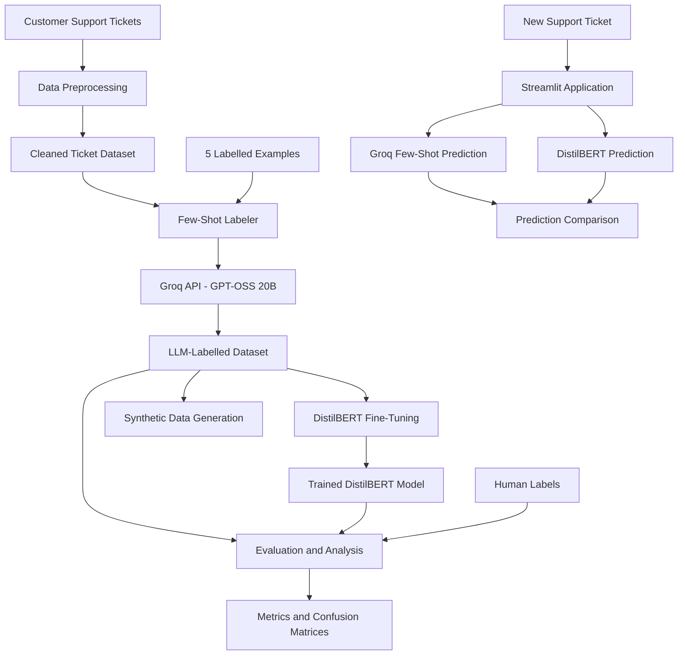
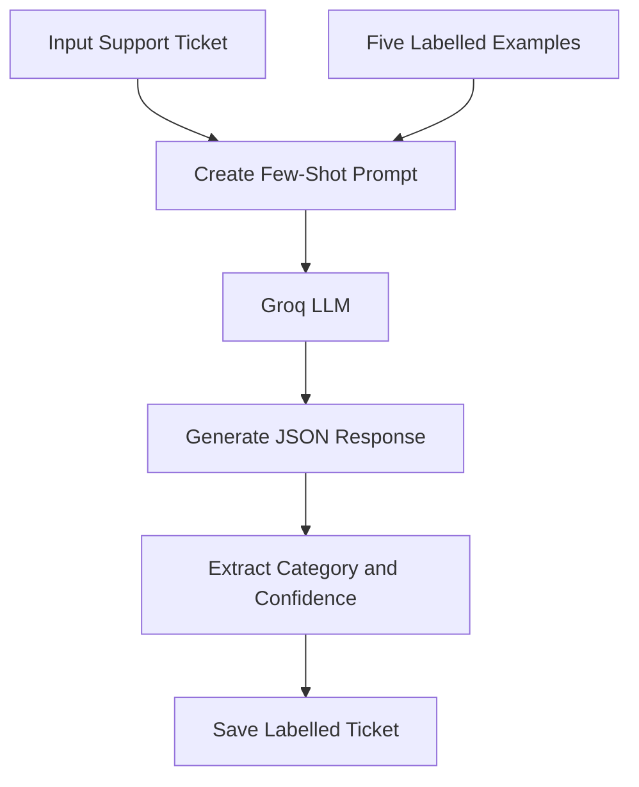
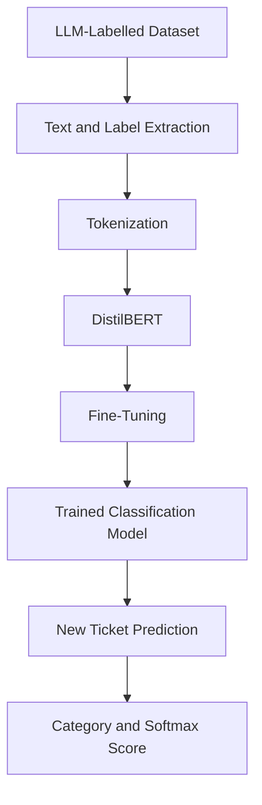

# Few-Shot Data Labeler

### AI-Powered Support Ticket Classification using Few-Shot Learning and Fine-Tuned DistilBERT

<p align="center">
  <strong>Groq LLM · Few-Shot Prompting · DistilBERT · Streamlit</strong>
</p>

<p align="center">
  
  
  
  
  
</p>

---

## Overview

**Few-Shot Data Labeler** is an AI-powered system that automatically classifies customer support tickets into predefined categories using Large Language Models and Transformer-based classification.

The project explores how an LLM can classify text using only a small number of labelled examples and how its generated labels can be used to train a smaller, specialized model.

It combines **Few-Shot Learning with Groq** and **DistilBERT fine-tuning** to compare two approaches to automated text classification.

The application also includes confidence estimation, model evaluation, synthetic data generation, and label noise analysis.

## Key Features

- **Few-Shot Classification:** Classifies support tickets using five labelled examples in the prompt.
- **LLM-Based Labelling:** Uses Groq API with the `openai/gpt-oss-20b` model.
- **Confidence Estimation:** Captures the LLM's estimated confidence and DistilBERT's softmax score.
- **Knowledge Distillation Workflow:** Uses LLM-generated labels to create a small training dataset for DistilBERT.
- **Ticket Prediction:** Predicts support ticket categories using the fine-tuned DistilBERT model.
- **Model Comparison:** Compares Groq and DistilBERT predictions against human-labelled examples.
- **Synthetic Data Generation:** Generates additional examples for underrepresented categories.
- **Bias and Noise Analysis:** Examines category distribution, disagreements, and classification errors.
- **Interactive Dashboard:** Provides a Streamlit interface to test both classifiers.

## Architecture

### System Architecture



### Few-Shot Labelling Workflow



### DistilBERT Training Workflow



## Classification Categories

The system supports six customer support categories:

| Category | Description |
|---|---|
| `api` | API integration, endpoints, SDKs, webhooks |
| `billing` | Payments, invoices, charges, transactions |
| `cancellation` | Subscription cancellation and account closure |
| `complaint` | Customer dissatisfaction and service complaints |
| `technical` | Application errors, bugs, and technical issues |
| `upgrade` | Plan changes, upgrades, and premium features |

## Technology Stack

| Technology | Purpose |
|---|---|
| Python | Core development |
| Pandas, NumPy | Data processing |
| Groq API | Few-shot LLM classification |
| GPT-OSS 20B | LLM used for ticket labelling |
| Hugging Face Transformers | Transformer model implementation |
| DistilBERT | Fine-tuned text classifier |
| PyTorch | Model training and inference |
| Scikit-learn | Evaluation metrics |
| Matplotlib | Confusion matrix and visualizations |
| Streamlit | Interactive web application |
| Hugging Face Hub | Model hosting |
| Git and GitHub | Version control |

## Project Structure

```text
few-shot-data-labeler/
│
├── app.py
├── download_dataset.py
├── requirements.txt
├── README.md
├── .gitignore
│
├── data/
│   ├── raw/
│   │   └── unlabelled_tickets.csv
│   │
│   ├── processed/
│   │   ├── cleaned_tickets.csv
│   │   └── labelled_tickets.csv
│   │
│   └── human/
│       └── human_labels.csv
│
├── src/
│   ├── preprocessing.py
│   ├── confidence.py
│   ├── few_shot_labeler.py
│   ├── train_distilbert.py
│   ├── predict.py
│   ├── evaluation.py
│   ├── augmentation.py
│   └── bias_analysis.py
│
├── models/
│   └── distilbert/
│
└── outputs/
    ├── evaluation_results.csv
    ├── augmented_examples.csv
    ├── label_distribution.png
    ├── groq_confusion_matrix.png
    └── distilbert_confusion_matrix.png
```

**Note:** Dataset files, model weights, environment files, and generated outputs are excluded from the Git repository. The trained model can be hosted separately on Hugging Face Hub.

## Getting Started

### 1. Clone the Repository

```bash
git clone https://github.com/alobroke/few_short_data_labeler.git

cd few_short_data_labeler
```

### 2. Create a Virtual Environment

```bash
python -m venv .venv
```

Activate it on Windows:

```powershell
.venv\Scripts\activate
```

### 3. Install Dependencies

```bash
pip install -r requirements.txt
```

### 4. Configure Groq API

Create a `.env` file in the project root:

```env
GROQ_API_KEY=your_groq_api_key
```

Get an API key from [Groq Console](https://console.groq.com/).

Never commit your API key to GitHub.

### 5. Prepare the Dataset

Run the dataset downloader:

```bash
python download_dataset.py
```

Preprocess the tickets:

```bash
python -m src.preprocessing
```

### 6. Generate Few-Shot Labels

```bash
python -m src.few_shot_labeler --limit 30
```

The system uses five labelled examples in its prompt and generates labels for a small sample of tickets.

### 7. Train DistilBERT

```bash
python -m src.train_distilbert
```

The trained model is saved locally in:

```text
models/distilbert/
```

### 8. Test Predictions

```bash
python -m src.predict
```

### 9. Evaluate Models

Complete the `human_label` column in:

```text
data/human/human_labels.csv
```

Use the six supported categories and have an independent reviewer assign the labels.

Run:

```bash
python -m src.evaluation
```

### 10. Generate Synthetic Examples

```bash
python -m src.augmentation
```

### 11. Analyse Bias and Label Noise

```bash
python -m src.bias_analysis
```

### 12. Launch Streamlit

```bash
streamlit run app.py
```

The application will be available at:

```text
http://localhost:8501
```

## Evaluation Methodology

The project compares two classification approaches:

**1. Groq Few-Shot Classifier**
- Uses five labelled examples.
- Generates a category using an LLM.
- Returns a model-estimated confidence score.

**2. Fine-Tuned DistilBERT**
- Trained using LLM-generated labels.
- Uses a Transformer-based classification head.
- Returns predicted categories and softmax scores.

### Evaluation Metrics

| Metric | Purpose |
|---|---|
| Accuracy | Overall classification correctness |
| Macro F1-score | Performance across all categories |
| Confusion Matrix | Identifies category-level misclassifications |
| Agreement Percentage | Percentage of predictions matching human labels |
| Confidence Analysis | Examines model confidence scores |

Evaluation uses a set of 50 human-reviewed tickets.

**Important:** Human annotations must be independently assigned. LLM-generated labels must not be treated as independent human ground truth.

## Outputs

The project generates the following artifacts:

| File | Description |
|---|---|
| `labelled_tickets.csv` | Groq-labelled support tickets |
| `evaluation_results.csv` | Human, Groq, and DistilBERT predictions |
| `augmented_examples.csv` | Synthetic support ticket examples |
| `label_distribution.png` | Category distribution visualization |
| `groq_confusion_matrix.png` | Groq classification results |
| `distilbert_confusion_matrix.png` | DistilBERT classification results |
| `label_disagreements.csv` | Records where model predictions disagree with human labels |

## Limitations

- The prototype uses a small training dataset.
- Model performance depends on the quality and distribution of generated labels.
- LLM-estimated confidence is not the same as token probability.
- DistilBERT softmax scores are not necessarily calibrated probabilities.
- Synthetic examples may introduce additional label noise.
- Independent human annotations are essential for reliable evaluation.
- Results from a small prototype should not be generalized to production-scale support systems.

## Future Improvements

- Increase the size and diversity of the labelled dataset.
- Improve confidence calibration.
- Implement active learning for human-in-the-loop labelling.
- Experiment with additional Transformer architectures.
- Introduce class balancing and more systematic data augmentation.
- Add support for batch ticket classification.
- Improve model monitoring and error analysis.

## Dataset

Support Ticket Router dataset:

[Hugging Face – Support-Ticket-Router-12K-Cleaned](https://huggingface.co/datasets/cngchis/Support-Ticket-Router-12K-Cleaned)


<p align="center">
  <strong>Built to explore Few-Shot Learning, LLM-based Data Labelling, and Transformer Fine-Tuning.</strong>
</p>
